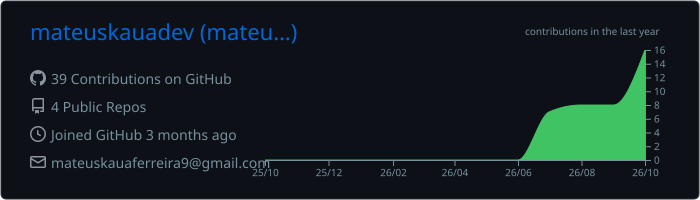
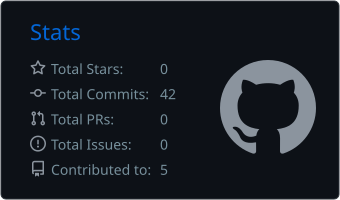
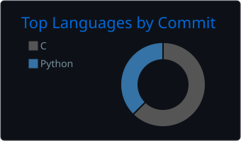

<!-- Banner -->
<p align="center">
  
</p>

<!-- Typing -->
<p align="center">
  
</p>

<p align="center">
  <a href="https://www.linkedin.com/in/mateuskferreira"></a>
  <a href="https://www.instagram.com/eu.kauac"></a>
  
</p>

---

##  Sobre mim

Oi! Sou o Mateus, estudante de **Ciência da Computação na UERJ**, no Rio de Janeiro.

Estou construindo meu caminho em **ciência de dados** com um objetivo claro: chegar em **engenharia de IA**. Por enquanto, isso quer dizer muito SQL, Python e projetos pequenos que respondem perguntas de verdade. O primeiro foi modelar o banco de dados de uma transportadora e descobrir quais entregas atrasavam e qual caminhão estava rodando acima da capacidade.

```txt
🎓  Ciência da Computação · UERJ
💼  Estagiário · Secretaria de Estado da Casa Civil (RJ)
🔭  Agora: Python e Pandas para análise de dados
🥋  Fora do código: jiu-jitsu
```

---

##  Tecnologias

<p align="center">
  
</p>

<p align="center">
  
  
  
</p>

---

##  Projetos

<table>
<tr>
<td width="50%" valign="top">

### [🚚 Banco de dados de uma transportadora](https://github.com/mateuskauadev/projeto_transportadora-sql)
Modelagem de 5 tabelas e 10 consultas SQL para analisar atrasos de entrega, uso da frota e excesso de carga nos caminhões.

 

</td>
<td width="50%" valign="top">

### [🐍 Estudos em Python](https://github.com/mateuskauadev/estudos-python)
Exercícios, desafios e projetos resolvidos durante o aprendizado de Python.


</td>
</tr>
<tr>
<td colspan="2" valign="top">

### [📦 Análise de atrasos nas entregas](https://github.com/mateuskauadev/projeto_entregas-excel)
Análise de 99 mil pedidos reais de e-commerce no Excel: 6,8% das entregas atrasam, e Alagoas atrasa quase 5 vezes mais que São Paulo.


</td>
</tr>
<tr>
<td colspan="2" valign="top">

### [🎓 Estudos da graduação · UERJ](https://github.com/mateuskauadev/uerj-estudos)
Códigos em C da disciplina Construção de Algoritmos e um projeto de front-end, organizados por matéria.

  

</td>
</tr>
</table>

---

##  Estatísticas

<p align="center">
  
</p>

<p align="center">
  
  
</p>

<p align="center">
  
</p>

---

##  Contribuições

<p align="center">
  <picture>
    <source media="(prefers-color-scheme: dark)" srcset="https://raw.githubusercontent.com/mateuskauadev/mateuskauadev/output/github-snake-dark.svg" />
    <source media="(prefers-color-scheme: light)" srcset="https://raw.githubusercontent.com/mateuskauadev/mateuskauadev/output/github-snake.svg" />
    
  </picture>
</p>

---

<p align="center">
  <i>Um commit por dia, uma pergunta respondida por vez.</i>
</p>

<!-- Rodapé -->
<p align="center">
  
</p>
